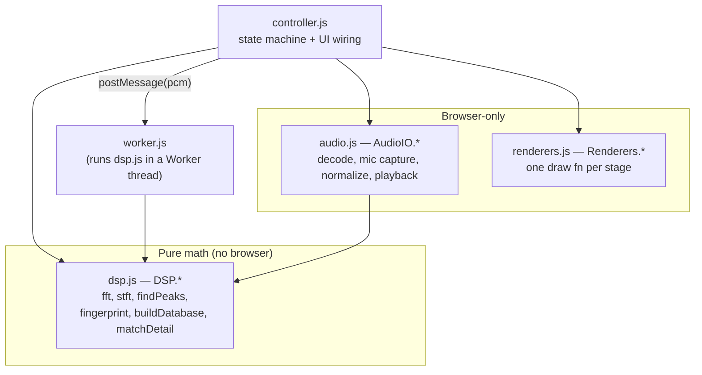
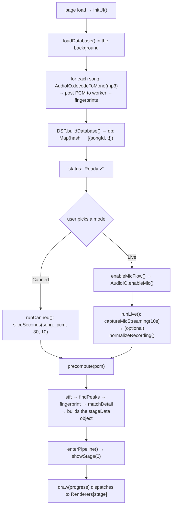

# Code Guide

A developer's tour of the codebase — how the app is wired, how data flows from a
recording to a match, and where to change things. For the *algorithm* itself
(why each stage exists, the analogies), read `docs/how-it-works.html`; this
document is about the **code**.

---

## 1. What the app is

A single self-contained `shazam-demo.html` that runs entirely in the browser,
offline, from `file://`. There is no server and no framework — just plain ES5-ish
JavaScript in IIFE modules that hang their exports off a global (`DSP`, `AudioIO`,
`Renderers`, `App`). `build.mjs` concatenates the source and embeds the songs into
one HTML file.

The source you actually edit lives in `src/`:

| File | Role |
|------|------|
| `src/dsp.js` | Pure DSP math — the whole fingerprinting algorithm. No DOM, no Web Audio. |
| `src/audio.js` | Browser audio I/O — mic capture, MP3 decode, resample, normalize, playback. |
| `src/worker.js` | Web Worker entry — fingerprints songs off the main thread. |
| `src/renderers.js` | One Canvas 2D renderer per pipeline stage. |
| `src/controller.js` | The orchestrator / state machine — boots everything and drives the UI. |
| `src/template.html` | HTML shell with placeholders the build fills in. |
| `src/styles.css` | Styles (inlined into the shell at build). |
| `build.mjs` | Node build script → `shazam-demo.html`. |
| `test/*.test.js` | `node --test` unit tests for the DSP core. |

> `songs/*.mp3` and the built `shazam-demo.html` are **gitignored** (copyrighted audio
> stays local). Drop your own MP3s into `songs/` and run `npm run build`.

---

## 2. The layers



Key idea: **`dsp.js` is the same file everywhere.** It runs in Node (the tests),
on the main thread (the browser `<script>`), and inside the Worker. It touches no
DOM and no Web Audio, so it has no environment dependencies — that's why the build
can just prepend it to `worker.js` and it works.

`audio.js` is the opposite: Web Audio is main-thread-only, so *all* audio I/O
lives here rather than in the worker.

---

## 3. How the single file is assembled (`build.mjs`)

`src/template.html` has four placeholders that the build replaces:

- `/*__STYLES__*/` → the contents of `styles.css`.
- `/*__SONGS__*/` → `var SONGS = [{ id, artist, title, mime, data(base64) }, …]` from `songs/*.mp3`.
- `/*__WORKER__*/` → `var WORKER_SOURCE = "<dsp.js + worker.js as a string>"`.
- `/*__SCRIPT__*/` → `dsp.js + audio.js + renderers.js + controller.js`, concatenated.

The worker is shipped as a **string** (`WORKER_SOURCE`) so the controller can spin
it up from a `Blob` URL — no separate file to fetch, which is what lets the whole
thing run from `file://`. See `controller.js → makeWorker()`.

Songs are base64-encoded and inlined, so more/larger songs = a bigger file and a
slower first-load analysis (~5–10 songs is the sweet spot).

---

## 4. End-to-end data flow

From opening the page to a match on screen:



Two entry points converge on **`precompute(pcm)`**: whether the 10 seconds of audio
come from a canned song slice or a live mic recording, everything downstream is
identical. `precompute` runs the DSP pipeline once and stashes every artifact each
renderer might need on a single `stageData` object.

---

## 5. The DSP core (`src/dsp.js`)

Everything is a pure function over `Float`/`Map`. All tunables are in one `CONFIG`
object at the top:

```js
sampleRate: 11025, frameSize: 1024, hopSize: 512,   // ~93 ms frames, 50% overlap
peakNeighborhoodTime: 3, peakNeighborhoodFreq: 3, peaksPerFrameCap: 5,
targetZoneMinDt: 1, targetZoneMaxDt: 63, targetZoneFreqRange: 200,
fanout: 12, minScore: 5,
```

The pipeline, in call order:

1. **`stft(pcm)`** → `{ columns, numFrames, numBins }`. Slides a Hann-windowed
   `fft` across the signal (`frameSize` samples, `hopSize` step) and stores one
   magnitude column per frame. That's the spectrogram.
2. **`findPeaks(spec)`** → `[{ t, f, mag }]`. Keeps only local maxima within a
   time×frequency neighborhood, then the strongest `peaksPerFrameCap` per frame.
   *This test is purely relative* — it compares each bin to its neighbors, with no
   absolute amplitude threshold. That's why scaling the audio (e.g. normalization)
   doesn't change which peaks are chosen, so **matching is amplitude-invariant**.
3. **`fingerprint(peaks)`** → `[{ hash, t }]`. Pairs each anchor peak with later
   peaks in a "target zone" and packs `(f1, f2, Δt)` into one 32-bit int:
   ```js
   const hash = (((a.f & 0x1FF) << 23) | ((b.f & 0x1FF) << 14) | (dt & 0x3FFF)) >>> 0;
   ```
   9 bits per frequency bin + 14 bits for the time delta = 32 bits exactly.
4. **`buildDatabase(perSong)`** → `Map(hash → [{ songId, t }])`. The catalog: every
   fingerprint of every song, indexed by hash. (The "library of shelves and books"
   analogy in the how-it-works page.)
5. **`matchQuery(queryFps, db)`** / **`matchDetail(...)`** → for each query hash,
   every DB hit votes for a `(songId, offset)` where `offset = songTime − queryTime`.
   The real song piles up votes at *one* consistent offset; noise scatters.
   `matchDetail` additionally returns the full vote map and a few example "shelves"
   for the matching-stage visualisation.

`matchQuery` is the lean version used by the self-test; `matchDetail` is what the UI
uses (it keeps `votes`, `examples`, and vote counts for the reveal). `worker.js` runs
steps 1–3 for each song during DB build; the controller runs 1–5 for the query clip
in `precompute`.

---

## 6. Data structures you'll see everywhere

- **`spec`** = `{ columns: Float32Array[], numFrames, numBins }` — the spectrogram;
  `columns[t][b]` is the magnitude of frequency bin `b` at time frame `t`.
- **`peaks`** = `[{ t, f, mag }]` — frame index, frequency bin, magnitude.
- **`fingerprints`** = `[{ hash, t }]` — `hash` is the 32-bit int, `t` the anchor frame.
- **`db`** = `Map(hash → [{ songId, t }])` — the catalog.
- **`results`** = `[{ songId, score, offset }]`, best first — from `matchDetail`.
- **`stageData`** — the **central object** the whole UI reads. Built by `precompute`:
  ```js
  { pcm, sr, spec, peaks, fingerprints, results, matchDetail,
    songs, matchedSong, bestGuessSong, confident, focusFrame,
    /* runtime UI fields added later: */ playhead, subStep, fpMode, fpSelected, fpSegments }
  ```
  `confident` is the go/no-go for revealing a match: the top score must clear
  `minScore` **and** be ≥ 3× the runner-up (a real match spikes far above the
  scatter). `focusFrame` is the slice Stages 2–3 zoom into (draggable, and it
  follows the playhead during Fourier-stage playback).

---

## 7. The microphone capture pipeline (`src/audio.js`)

This is the subtlest part of the codebase — it went through several rewrites to get
a clean live recording on Windows/Chrome. The mental model:

**Capture is a two-step flow.** `enableMic()` builds and *keeps running* the whole
pipeline — the mic stream, an `AudioContext`, a `MediaStreamSource`, an
`AnalyserNode`, and a silent keep-alive node. `captureMicStreaming()` then only
attaches a `MediaRecorder` to that already-warm stream.

Why it's split, and the non-obvious choices:

- **Warm-up first.** When a mic first opens, Windows/Chrome spend ~1–2 s
  reconfiguring the audio pipeline, during which capture briefly drops to silence.
  Enabling the mic as its own step lets that settle *before* the timed recording, so
  the glitch never lands inside the take. This is the whole reason for the separate
  "Enable microphone" button.
- **Never route the mic to `ac.destination`.** Sending the mic toward an output makes
  Windows treat it as a "communications" stream and apply processing that silences a
  loud sustained input. The `AnalyserNode` (for the live meter/waveform) is *not*
  connected onward; a separate silent `ConstantSourceNode → gain(0) → destination`
  keeps the audio graph rendering without the mic ever reaching an output.
- **`MediaRecorder` is the authoritative recording**; the `AnalyserNode` only drives
  the on-screen waveform. `stopMic()` releases the mic the instant recording ends
  (otherwise Windows keeps ducking other audio, e.g. the Play-clip playback). It's
  also called from `goHome()` and `runCanned()`.
- **`normalizeRecording(pcm)`** evens out a quiet or slowly-fading capture by dividing
  by a smoothed short-time RMS envelope toward a target level (a gentle AGC). It's
  purely cosmetic — because peak-picking is relative (see §5), it does **not** affect
  matching. It's gated behind the start-screen "Even out recording volume" toggle
  (`#normChk`).

Other helpers here: `decodeToMono` (MP3 → mono PCM at the DSP sample rate, via an
`OfflineAudioContext`), `sliceSeconds`, `resampleLinear`, and `makeSource` (playback
of a PCM buffer, exposing `elapsed()` / `isEnded()` for the playhead loop).

---

## 8. Rendering & animation (`renderers.js` + the controller draw loop)

`Renderers` is a map of stage name → draw function, all with the same signature:

```js
Renderers.waveform = (ctx, d, p, W, H) => { … }   // d = stageData, p = progress 0..1
```

The controller never calls a renderer directly. It calls **`draw(progress)`**, which
clears the canvas and dispatches to the renderer for the current stage:

```js
(root.Renderers[STAGES[stageIdx][0]] || (()=>{}))(ctx, stageData, progress, W, H);
```

- **`STAGES`** is the ordered list of `[name, caption]`. `stageIdx` is where we are.
- **`animateStage()`** runs a ~2.2 s eased ramp of `progress` from 0→1 via
  `requestAnimationFrame`, so each stage "reveals" itself. `draw(1)` is the finished
  frame.
- **`STAGE_SUBSTEPS = [1,1,2,1,1,2]`** — the spectrogram and matching stages reveal in
  *two* Next-presses. `nextStep()`/`prevStep()` advance the `subStep` first, then the
  stage; renderers read `d.subStep` to know how much to show.
- **Playback:** `PLAYHEAD = { 0:'cursor', 1:'slice' }` declares which stages support
  the Play-clip button and what the playhead drives — the waveform cursor on stage 0,
  the analysed slice on the Fourier stage (stage 1). `startPlayheadLoop()` reads
  `playSource.elapsed()` each frame; on the Fourier stage it moves `focusFrame` (and
  only redraws when it actually changes, to avoid recomputing an identical FFT).
  `isPlayable(stageIdx)` is the single source of truth for "does this stage play".

Canvas is sized for `devicePixelRatio` in `resize()`; `dims()` returns CSS pixels.

---

## 9. The controller as a state machine (`src/controller.js`)

Module-level state (top of the IIFE) is the whole "current view":

```js
let canvas, ctx, stageData=null, db=null, dbReady=null,
    stageIdx=0, anim=null, playSource=null, playAnim=null, subStep=0;
let fpMode='spread';
```

The important functions:

- **`initUI()`** (on `DOMContentLoaded`) — wires buttons/keys, kicks off
  `loadDatabase()` in the background, and enables the mode buttons when it resolves.
- **`loadDatabase(songs, onProgress)`** — for each song: decode on the main thread,
  fingerprint in the worker, then `buildDatabase`. Resilient: a bad song is skipped
  with a `console.warn` rather than bricking the demo. Stashes each song's PCM on
  `song._pcm` so canned mode can slice it later.
- **`enableMicFlow()` → `runLive()`** and **`runCanned()`** — the two ways to get
  10 s of PCM; both end in `precompute()` → `enterPipeline()`.
- **`showStage(i)` / `nextStep()` / `prevStep()`** — navigation; they also stop
  playback on a stage change and re-run the reveal animation.
- **`goHome()`** — tears everything down (stops playback, releases the mic, clears
  `stageData`) and returns to the start screen so a new mode can be chosen without a
  page reload.

Keyboard: Space/→ next, ← prev, R replay. `?selftest` in the URL exposes
`window.__selfTest()` for headless verification (loads the DB, matches a known clip,
returns the top result).

---

## 10. How to make common changes

- **Swap/add songs:** put `Artist - Title.mp3` files in `songs/`, run `npm run build`.
- **Re-tune the algorithm:** edit `CONFIG` in `src/dsp.js` (one place). Larger
  `peaksPerFrameCap`/`fanout` = denser fingerprints; `minScore` gates a confident match.
- **Change match confidence:** the `confident` heuristic is in `precompute()`
  (`controller.js`), not in the DSP core.
- **Add or reorder a stage:** add an entry to `STAGES`, a matching `Renderers.<name>`
  draw function, and (if it reveals in two presses) a `STAGE_SUBSTEPS` entry.
- **Adjust live capture:** mic constraints and the warm-pipeline setup are in
  `enableMic()`; the normalization curve is in `normalizeRecording()` (both in
  `src/audio.js`).
- **Run the DSP tests:** `npm test` (`node --test`).

---

## 11. Gotchas

- **Web Audio is main-thread only** — that's why all audio I/O is in `audio.js`, not
  the worker. The worker only does pure DSP.
- **The worker is `dsp.js` + `worker.js`** concatenated at build time, shipped as the
  `WORKER_SOURCE` string and started from a Blob URL. `dsp.js` must stay
  environment-free for this to work.
- **`file://` never remembers mic permission** — the browser re-asks on every load.
  The "Enable microphone" step exists partly to make that a deliberate, one-time
  action per session.
- **Normalization is cosmetic**, never a matching lever — keep it that way (peak
  selection is relative; see §5).
- **`songs/` and `shazam-demo.html` are gitignored** — cloning the repo gives you
  source only; you supply songs and build.

---

For the algorithm and the presenter-facing narrative, see `docs/how-it-works.html`.
